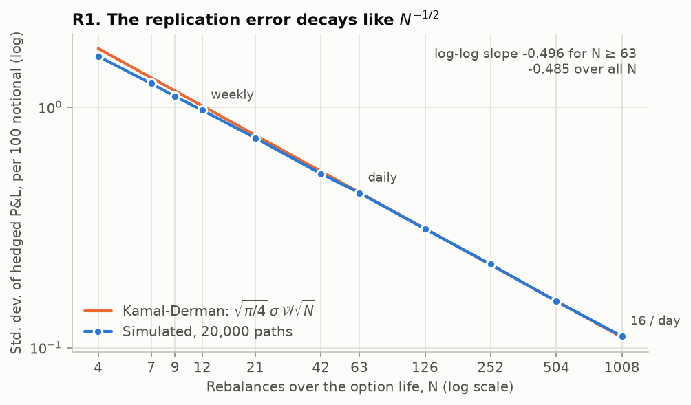
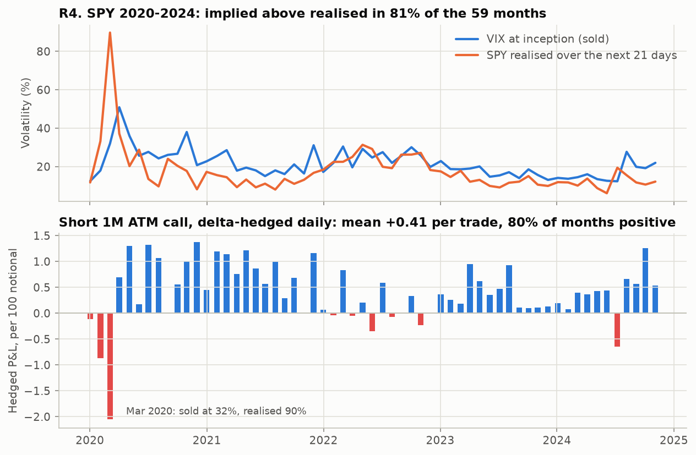
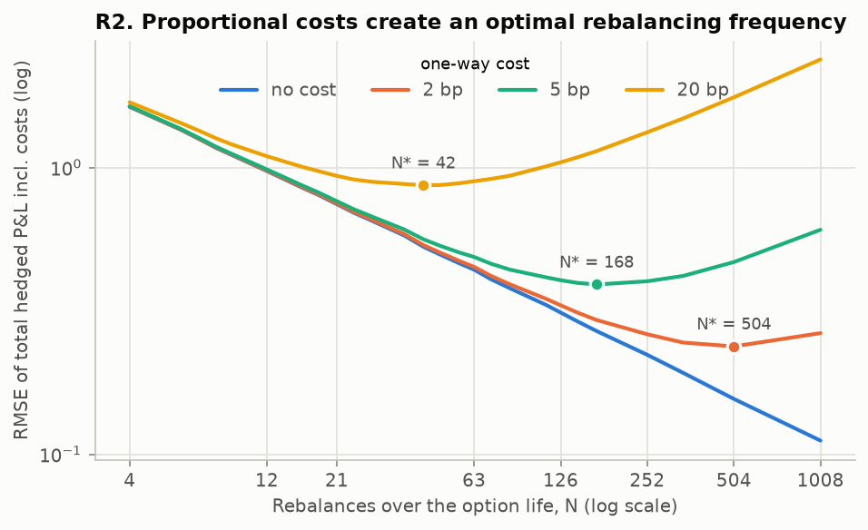
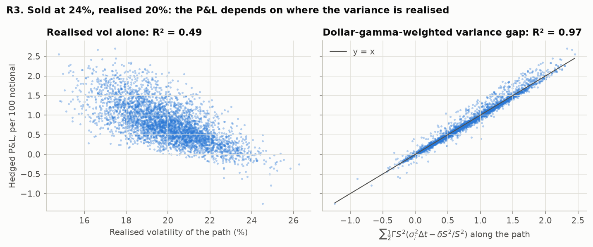

# Black-Scholes pricer and delta-hedging simulator

[](https://github.com/tancredeg/black-scholes-pricer/actions/workflows/ci.yml)

[](LICENSE)

**How much does a discretely rebalanced delta hedge leak, through rebalancing frequency, transaction costs and a wrong volatility, and what did selling SPY volatility at the VIX actually earn in 2020–2024?** Measured with a tested Black-Scholes-Merton library, Monte Carlo with common random numbers, an exact gamma / theta / carry attribution of the hedged P&L, and a backtest on real SPY closes.

## Key results

Every number below is written by `scripts/run_results.py` into `results/` and copied here by the same script; `tests/test_readme.py` fails if this section and `results/summary.json` disagree. P&L figures are per 100 of notional (spot = 100), from the point of view of the option seller.

<!-- BEGIN GENERATED: key-results -->
| Result | Measurement | Interpretation |
|---|---|---|
| **R1** Replication error vs. rebalancing frequency (Monte Carlo) | log-log slope **−0.496** (95 % CI −0.502 to −0.490) for N ≥ 63; daily hedge leaves sd = 10.1 % of the premium, 1.00× the Kamal-Derman value | The error decays like 1/√N: halving it takes four times as many rebalances. |
| **R2** Optimal rebalancing with proportional costs | N\* = **504 / 168 / 84 / 42** rebalances at 2 / 5 / 10 / 20 bp one-way cost (model: 507 / 195 / 94 / 44); at 1 bp the RMSE still falls at the finest grid point, N = 1008 (model: 1034) | Each doubling of the cost roughly halves the optimal number of rebalances (N\* ∝ 1/c to leading order). |
| **R3** Misspecified volatility (sold at σᵢ, realised σᵣ = 20 %) | mean P&L = dollar-gamma × variance gap to within 2.0 SE for σᵢ from 14 % to 26 %; at σᵢ = 24 %, path-wise R² **0.97** vs 0.49 for realised vol alone | The P&L depends on *where* variance is realised: with realised vol within ±0.5 pt of 20 %, it still ranges from 0.26 to 1.47 (5th–95th pct.). Hedging at the realised instead of the implied vol cuts its sd from 0.29 to 0.11 (N = 1008). |
| **R4** SPY 2020–2024: short 1-month ATM call sold at the VIX, hedged daily on real closes | 59 monthly trades: mean **+0.41** (SE 0.08) per 100 notional (16 % of the premium), 80 % positive; VIX above realised vol in 81 % of months | Selling implied vol earned a premium, paid for by crash risk: the worst month (2020-03, sold at 32 %, realised 90 %) lost 2.04, about 5 average months. |




<!-- END GENERATED: key-results -->

<!-- BEGIN GENERATED: details -->
<details><summary><b>R1</b> Replication error by rebalancing frequency</summary>

20,000 paths, common random numbers (the same Brownian paths observed at every N). Premium 4.3576, vega 19.792.

| N | per day | sd(P&L) | sd / premium | Kamal-Derman | ratio |
|---:|---:|---:|---:|---:|---:|
| 4 | 0.06 | 1.6268 | 37.33 % | 1.7540 | 0.927 |
| 7 | 0.11 | 1.2540 | 28.78 % | 1.3259 | 0.946 |
| 9 | 0.14 | 1.1082 | 25.43 % | 1.1693 | 0.948 |
| 12 | 0.19 | 0.9717 | 22.30 % | 1.0127 | 0.960 |
| 21 | 0.33 | 0.7447 | 17.09 % | 0.7655 | 0.973 |
| 42 | 0.67 | 0.5288 | 12.14 % | 0.5413 | 0.977 |
| 63 | 1.00 | 0.4402 | 10.10 % | 0.4420 | 0.996 |
| 126 | 2.00 | 0.3118 | 7.16 % | 0.3125 | 0.998 |
| 252 | 4.00 | 0.2221 | 5.10 % | 0.2210 | 1.005 |
| 504 | 8.00 | 0.1559 | 3.58 % | 0.1563 | 0.998 |
| 1008 | 16.00 | 0.1116 | 2.56 % | 0.1105 | 1.010 |

Slope over all N from 4: −0.485 (95 % CI −0.488 to −0.482). At N = 4 the simulated sd is 0.93× the Kamal-Derman value: the formula is asymptotic. Mean P&L: largest |t| across N is 3.0 on these shared paths; an independent run of 200,000 fresh paths hedged daily gives a mean of +0.0009 (t = 0.91), consistent with an unbiased hedge.

</details>

<details><summary><b>R2</b> Optimal rebalancing frequency with proportional costs</summary>

Criterion: N\* minimises the RMSE of the total P&L, costs included, on the grid of divisors of 1008. Model: sd² ≈ a/N and traded notional ≈ F + b√N, with a = 12.25, F = 108.8 (entry and exit trades; the initial delta alone is 55.0) and b = 32.2 (fit error ≤ 4.4 %).

| one-way cost | N\* (simulated) | N\* (model) | RMSE at N\* | mean cost at N\* | RMSE if daily |
|---:|---:|---:|---:|---:|---:|
| 1 bp | ≥ 1008 | 1034 | 0.165 | 0.113 | 0.444 |
| 2 bp | 504 | 507 | 0.238 | 0.166 | 0.450 |
| 5 bp | 168 | 195 | 0.391 | 0.264 | 0.487 |
| 10 bp | 84 | 94 | 0.577 | 0.406 | 0.595 |
| 20 bp | 42 | 44 | 0.866 | 0.639 | 0.895 |

Fitted scaling of the simulated optimum: N\* ∝ c^−1.08.



</details>

<details><summary><b>R3</b> Misspecified volatility</summary>

Paths at σᵣ = 20 %, daily rebalancing; the option is sold and hedged at σᵢ. Prediction: E[Σ ½ e^{r(T−t)} Γ S² (σᵢ² − σᵣ²) Δt] along the simulated paths.

| σᵢ | mean P&L | SE | predicted | premium edge e^{rT}(V(σᵢ) − V(σᵣ)) | sd | P(P&L > 0) |
|---:|---:|---:|---:|---:|---:|---:|
| 14 % | −1.203 | 0.005 | −1.199 | −1.195 | 0.695 | 0.1 % |
| 16 % | −0.805 | 0.004 | −0.799 | −0.797 | 0.556 | 2.3 % |
| 18 % | −0.405 | 0.003 | −0.399 | −0.399 | 0.469 | 16.3 % |
| 20 % | −0.006 | 0.003 | +0.000 | +0.000 | 0.440 | 49.7 % |
| 22 % | +0.393 | 0.003 | +0.399 | +0.399 | 0.461 | 82.3 % |
| 24 % | +0.793 | 0.004 | +0.797 | +0.798 | 0.515 | 96.5 % |
| 26 % | +1.192 | 0.004 | +1.195 | +1.197 | 0.585 | 99.5 % |

Path dependence at σᵢ = 24 %: regressing the P&L on the path-wise proxy Σ ½ Γ S² (σᵢ²Δt − δS²/S²) gives slope 1.020 and R² 0.974; on σᵢ² − σ̂ᵣ² alone, R² 0.490. Among the 4,405 paths whose realised vol is within ±0.5 pt of 20 %, those ending within 2 % of the strike earn 1.29 on average against 0.69 for the others: gamma is largest there.

Which volatility to hedge with (sold at σᵢ, Ahmad-Wilmott 2005):

| hedge vol | N | mean P&L | sd | P(loss) |
|---|---:|---:|---:|---:|
| implied (24 %) | 63 | +0.793 | 0.515 | 3.5 % |
| implied (24 %) | 1008 | +0.798 | 0.292 | 0.0 % |
| realised (20 %) | 63 | +0.792 | 0.440 | 4.0 % |
| realised (20 %) | 1008 | +0.797 | 0.112 | 0.0 % |

Locked-in value e^{rT}(V(σᵢ) − V(σᵣ)) = +0.798: hedging at the realised vol converges to it, hedging at the implied vol keeps a path-dependent residual.



</details>

<details><summary><b>R4</b> SPY backtest, robustness</summary>

59 non-overlapping 21-trading-day trades from 2020-01-02 to 2024-12-04. Mean implied (VIX) 21.6 %, mean realised 17.6 %; median P&L +0.39, skewness −1.15. Mean attribution per trade: theta +1.37, gamma −0.85, carry −0.13. Path-wise R² of the dollar-gamma proxy 0.98, of VIX² − σ̂² alone 0.52.

| variant | trades | mean P&L | SE | P(P&L > 0) | worst |
|---|---:|---:|---:|---:|---:|
| baseline | 59 | +0.405 | 0.077 | 79.7 % | −2.04 |
| sold 2 vol points below VIX | 59 | +0.191 | 0.074 | 64.4 % | −1.97 |
| 1 bp one-way cost | 59 | +0.382 | 0.077 | 78.0 % | −2.06 |

Moving the first trade date by 0 to 20 trading days changes the mean P&L between +0.343 and +0.539. The standard errors assume independent months.

</details>
<!-- END GENERATED: details -->

## Methodology

**Model.** Geometric Brownian motion with constant volatility σ, rate r and dividend yield q (Black-Scholes-Merton). Prices and Greeks are closed form; Greeks are raw partial derivatives (theta per year, vega per unit of vol). The closed form is cross-checked against an independent pure-Python implementation, central finite differences, the PDE residual, a CRR binomial tree (order 1 convergence) and Monte Carlo (order 1/2).

**Hedging engine** (`bspricer.delta_hedge`). The hedger sells one European option at the Black-Scholes price for a selling volatility, holds Δ shares computed with a hedging volatility, finances the position in a cash account at r, receives the dividends on the shares held and pays a proportional cost on every trade, including the initial purchase and the final unwind. The step is Δt = T/N from the path grid. The P&L at expiry is decomposed exactly into initial mark, gamma (−½ΓδS²), theta (−ΘΔt), carry (financing and dividends), a third-order residual and costs. To leading order, gamma + theta + carry = ½ΓS²(σₕ²Δt − (δS/S)²): the seller earns the gap between the hedging variance and the realised variance, weighted by dollar gamma.

**Monte Carlo design (R1–R3).** At-the-money call, S₀ = K = 100, T = 3 months (63 trading days), r = 3 %, q = 0, realised σ = 20 %, real-world drift 7 %. Paths are simulated once on a grid of 1,008 steps (16 per trading day); a hedge rebalanced N times observes the same paths every 1,008/N steps (common random numbers), so differences between frequencies are not sampling noise. Seeds are fixed.

**Real-data backtest (R4).** SPY daily closes adjusted for dividends (a total-return series, so q = 0), 2020-01-02 to 2024-12-30. Every 21 trading days, sell a 21-day at-the-money call at the VIX close of the inception day, with r from the 3-month T-bill (discount yield converted to a continuous rate), delta-hedge it once a day on the observed closes and hold it to expiry; trades do not overlap. With q = 0 the engine gives the same P&L for a call and a put. Data are frozen in `data/sample/` (sources and checksums in [`data/sample/SOURCE.md`](data/sample/SOURCE.md)).

**Limits, stated rather than hidden.**

* Constant volatility and continuous GBM paths: no stochastic volatility, no jumps, no smile. Misspecification is studied as one wrong constant σ.
* The VIX is not the implied vol of a 21-day at-the-money SPY option: it is a 30-calendar-day, variance-swap-style index on the S&P 500 that includes out-of-the-money puts, so it usually sits above at-the-money implied vol. No SPY option prices are used; one robustness row sells 2 vol points below the VIX.
* Daily closes only: the real-data hedge is rebalanced once a day, and realised vol is close-to-close.
* Costs are linear in traded notional: no market impact, no bid-ask on the option itself, no funding spread or margin.
* 2020–2024 contains one crash and 59 independent months; standard errors assume independence. The backtest illustrates the mechanics of the variance risk premium, it is not an investment strategy.
* Day count: 252 trading days per year for the hedging grid and the annualisation of realised vol; T-bill rates on an actual/365 basis.

## Reproduce

```bash
pip install -e ".[dev]"          # Python >= 3.12, pinned dependencies
python scripts/run_results.py    # regenerates results/, the figures and the tables above (about 30 s)
```

Quality gates, also run by CI on Python 3.12, 3.13 and 3.14:

```bash
python -m pytest                 # identities, limits, convergence, regression on frozen data, README check
ruff check . && ruff format --check . && mypy
```

```python
import bspricer as bs

paths = bs.simulate_gbm(100.0, 0.07, 0.20, 0.25, n_steps=63, n_paths=10_000, seed=0)
res = bs.delta_hedge(paths, K=100.0, T=0.25, r=0.03, sigma_hedge=0.20, cost=5e-4, decompose=True)
res.mean, res.std, res.decomposition.gamma.mean(), res.decomposition.theta.mean()
```

## Code structure

```
src/bspricer/
    pricing.py        closed-form prices, d1/d2, forward, no-arbitrage bounds
    greeks.py         analytical Greeks, PDE residual
    implied_vol.py    Brent root finding with explicit failure modes
    trees.py          CRR binomial tree (European and American)
    montecarlo.py     exact GBM paths, Monte Carlo pricer with antithetic variates
    hedging.py        discrete delta hedge, exact P&L attribution, Kamal-Derman formula
    backtest.py       short-vol backtest on a real price history
    vol.py            realised-vol estimators, loaders for the frozen data
scripts/
    run_results.py    regenerates results/ and the README tables
    readme_block.py   renders the generated README blocks from results/summary.json
    download_data.py  optional refresh of data/sample/ (network)
tests/                pytest suite, independent reference implementation in tests/reference.py
data/sample/          frozen SPY, VIX and T-bill series with SHA256SUMS
results/              CSV tables, summary.json and figures written by run_results.py
notebooks/demo.ipynb  guided tour, runs offline
docs/                 Phase 0 audit of the previous version (French) and progress log
```

## References

* Black, F. and Scholes, M. (1973). The Pricing of Options and Corporate Liabilities. *Journal of Political Economy*, 81(3), 637–654.
* Merton, R. C. (1973). Theory of Rational Option Pricing. *Bell Journal of Economics and Management Science*, 4(1), 141–183.
* Cox, J. C., Ross, S. A. and Rubinstein, M. (1979). Option Pricing: A Simplified Approach. *Journal of Financial Economics*, 7(3), 229–263.
* Leland, H. E. (1985). Option Pricing and Replication with Transactions Costs. *Journal of Finance*, 40(5), 1283–1301.
* Kamal, M. and Derman, E. (1999). Correcting Black-Scholes. *Risk*, 12(1), 82–85.
* Bakshi, G. and Kapadia, N. (2003). Delta-Hedged Gains and the Negative Market Volatility Risk Premium. *Review of Financial Studies*, 16(2), 527–566.
* Ahmad, R. and Wilmott, P. (2005). Which Free Lunch Would You Like Today, Sir? Delta Hedging, Volatility Arbitrage and Optimal Portfolios. *Wilmott Magazine*.
* Carr, P. and Wu, L. (2009). Variance Risk Premiums. *Review of Financial Studies*, 22(3), 1311–1341.
* Glasserman, P. (2003). *Monte Carlo Methods in Financial Engineering*. Springer.
* Hull, J. C. (2022). *Options, Futures, and Other Derivatives*, 11th ed. Pearson.
